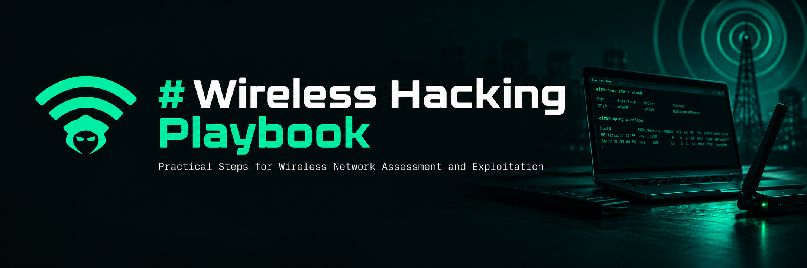

# Wireless Hacking Playbook

A comprehensive collection of notes, techniques, and references for wireless network security testing (Wi-Fi, Bluetooth, SDR).

> ⚠️ **Disclaimer:** This content is for educational purposes and security testing on networks you own or have written permission to test. Misuse is illegal.

---

## 📚 Repository Structure

### Foundations & Methodology
| Folder | Description |
|--------|-------------|
| `00-methodology/` | Pentest methodology, wireless fundamentals, legal & ethics, reporting |
| `01-reconnaissance/` | Frequency, scanning, monitoring, information gathering |

### Authentication Attacks
| Folder | Description |
|--------|-------------|
| `02-wep/` | WEP cracking (fake auth, ARP replay, fragmentation, chop chop, HIRTE, Cafe Latte) |
| `03-wpa-wpa2/` | WPA/WPA2 cracking (WPS, PMKID, handshake, Enterprise) |
| `04-wpa3/` | WPA3 attacks (downgrade, DragonBlood, DragonSlayer) |
| `05-wps/` | WPS attacks (Pixie Dust, bruteforce, null PIN) |

### Infrastructure Attacks
| Folder | Description |
|--------|-------------|
| `06-evil-twin/` | Rogue AP, Evil Twin, KARMA, MANA, Known Beacons |
| `07-pmkid/` | Clientless PMKID attack |
| `08-mitm/` | DoS, Captive Portal, Man-in-the-Middle |

### Modern & Advanced
| Folder | Description |
|--------|-------------|
| `11-modern-attacks/` | FragAttacks, SSID Confusion, OWE/Enhanced Open |
| `12-defensive/` | WIDS/WIPS, hardening, detection, incident response |
| `13-bluetooth-sdr/` | Bluetooth (BLE, KNOB, BleedingTooth), SDR (HackRF, RFID/NFC) |

### Tools & References
| Folder | Description |
|--------|-------------|
| `09-tools/` | Tools reference, hardware setup, portable pentest |
| `10-cheatsheet/` | Quick reference commands, wordlist generation |
| `references/` | Links, papers, documentation |

---

## 🗺️ Learning Path

### 🔰 Beginner
1. [Wireless Fundamentals](00-methodology/wireless-fundamentals.md)
2. [Legal & Ethics](00-methodology/legal-ethics.md)
3. [Information Gathering](01-reconnaissance/information-gathering.md)
4. [WEP Cracking](02-wep/wep-cracking.md)
5. [WPA/WPA2 Cracking](03-wpa-wpa2/wpa-wpa2-cracking.md)
6. [Cheatsheet](10-cheatsheet/cheatsheet.md)

### 🔷 Intermediate
1. [WPS Attacks](05-wps/wps-attacks.md)
2. [PMKID](07-pmkid/pmkid-attack.md)
3. [Evil Twin](06-evil-twin/rogue-ap-evil-twin.md)
4. [MITM & DoS](08-mitm/)
5. [WPA2 Enterprise](03-wpa-wpa2/wpa-enterprise.md)
6. [Reporting](00-methodology/reporting.md)

### 🔴 Advanced
1. [WPA3 Attacks](04-wpa3/wpa3-attacks.md)
2. [FragAttacks](11-modern-attacks/fragattacks.md)
3. [SSID Confusion](11-modern-attacks/ssid-confusion.md)
4. [Bluetooth Attacks](13-bluetooth-sdr/bluetooth-attacks.md)
5. [SDR Attacks](13-bluetooth-sdr/sdr-attacks.md)
6. [Defensive Security](12-defensive/wireless-defense.md)
7. [Hardware Setup](09-tools/hardware-setup.md)

---

## 📋 Complete Cheat Sheets

| Attack | Page |
|--------|------|
| Monitoring & Scanning | [cheatsheet.md](10-cheatsheet/cheatsheet.md#monitoring--scanning) |
| Denial of Service | [cheatsheet.md](10-cheatsheet/cheatsheet.md#denial-of-service) |
| WEP Cracking | [cheatsheet.md](10-cheatsheet/cheatsheet.md#wep-cracking) |
| WPA/WPA2 Cracking | [cheatsheet.md](10-cheatsheet/cheatsheet.md#wpawpa2-cracking) |
| Wordlist Generation | [wordlist-generation.md](10-cheatsheet/wordlist-generation.md) |

---

## 🛠️ Tools

| Category | Tools |
|----------|-------|
| **WiFi Auditing** | Aircrack-ng, Wifite, Kismet, Bettercap |
| **Password Cracking** | Hashcat, John the Ripper, coWPAtty, Pyrit |
| **Evil Twin** | EAPHammer, Airgeddon, Wifiphisher, Hostapd-mana |
| **Enterprise** | FreeRADIUS-WPE, Air-hammer, crEAP |
| **Modern** | FragAttack tool, DragonForce, DragonSlayer |
| **Bluetooth** | Ubertooth, BtleJack, GATTacker |
| **SDR** | HackRF, RTL-SDR, Proxmark3, URH |
| **Reporting** | Dradis, Faraday, PlexTrac |

---

## 📖 Key References

- [WiFi Hacking Mind Map](https://github.com/koutto/pi-pwnbox-rogueap/blob/main/mindmap/WiFi-Hacking-MindMap-v1.png)
- [Aircrack-ng Handbook](https://github.com/lucthienphong1120/Aircrack-ng-handbook)
- [WirelessPentesting-Cheatsheet](https://github.com/V0lk3n/WirelessPentesting-Cheatsheet)
- [Mathy Vanhoef Papers](https://papers.mathyvanhoef.com/)
- [NIST SP 800-97](https://csrc.nist.gov/publications/detail/sp/800-97/final)

---

## 📊 Coverage Score

| Category | Before | After | Status |
|----------|--------|-------|--------|
| Foundations & theory | 4/10 | **9/10** | ✅ Complete |
| Classic attacks (WEP/WPA) | 9/10 | **9/10** | ✅ Complete |
| Modern attacks (2020+) | 5/10 | **9/10** | ✅ Complete |
| Evil Twin & Rogue AP | 8/10 | **9/10** | ✅ Complete |
| Bluetooth & SDR | 2/10 | **8/10** | ✅ Complete |
| Defensive & hardening | 2/10 | **8/10** | ✅ Complete |
| Hardware & setup | 3/10 | **8/10** | ✅ Complete |
| Legal & reporting | 4/10 | **9/10** | ✅ Complete |
| **Overall** | **6/10** | **9/10** | ✅ **Comprehensive** |

---

## ⚖️ Contributing

1. Fork this repository
2. Create a branch: `git checkout -b feature/topic-name`
3. Add or improve content
4. Commit: `git commit -m "Add topic X notes"`
5. Push and create a Pull Request

## 📜 License

MIT License. See `LICENSE` file for details.

---

**Maintainer:** rasyidfox edited with MiMo
**Last Updated:** October 2026
